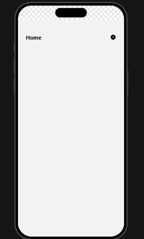
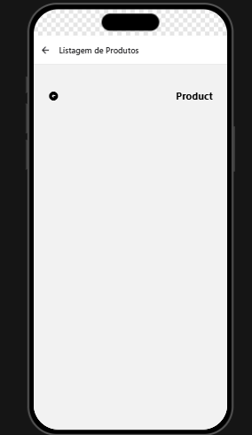

# my-app

**Aluno:** Cauã Ferreira Carvalho

## Sobre o app

Esse app foi feito em React Native com Expo (SDK 54) e React Navigation 7, para a matéria de Dispositivos Móveis. Comecei com a navegação em pilha que fizemos em aula e depois acrescentei as abas inferiores e o menu lateral.

O app tem quatro telas (Home, Product, Profile e Settings) e funciona de três jeitos diferentes. Para trocar entre eles eu só mudo uma linha no arquivo `src/routes/index.jsx`, sem precisar mexer em nenhuma tela.

Os três tipos de navegação são:

- **Stack (pilha):** a Home tem um botão `+` que abre a tela Product. Para voltar é só tocar na seta (ou no botão voltar do Android).
- **Bottom Tabs (abas inferiores):** uma barra no rodapé com 4 abas: Início, Produtos, Perfil e Configurações. A aba Produtos mostra um balãozinho vermelho com o número 3, e o ícone do Perfil muda de vazado para preenchido quando a aba está ativa.
- **Drawer (menu lateral):** um menu que abre pelo botão ☰ do cabeçalho ou arrastando o dedo a partir da borda esquerda. Ele tem 4 itens (Início, Produtos, Perfil e Configurações) e o item da tela atual fica destacado.

## Como rodar

Primeiro instale as dependências e depois inicie o projeto:

```bash
npm install
npx expo start
```

Aí é só abrir no Expo Go lendo o QR Code, ou usar `npm run android`, `npm run ios` ou `npm run web`.

Se aparecer algum erro estranho depois de instalar as bibliotecas, limpar o cache costuma resolver:

```bash
npx expo start --clear
```

## Como trocar o tipo de navegação

Abra o arquivo `src/routes/index.jsx`, troque o valor da constante `TIPO_DE_NAVEGACAO` e salve. O Expo recarrega o app sozinho.

```js
const TIPO_DE_NAVEGACAO = "stack";    // pilha
const TIPO_DE_NAVEGACAO = "bottom";   // abas inferiores
const TIPO_DE_NAVEGACAO = "drawer";   // menu lateral
const TIPO_DE_NAVEGACAO = "aninhado"; // desafio opcional
```

## Prints

### Stack

Tela Home com o botão `+` e, ao tocar nele, a tela Product com a seta de voltar.




### Bottom Tabs

Barra inferior com as 4 abas e o balãozinho vermelho "3" na aba Produtos.


### Drawer

Menu lateral aberto, mostrando os 4 itens com o item ativo destacado.


### Aninhado (desafio)

Drawer por fora, abas no meio e o Stack dentro da aba Início.


## Sobre o desafio:

Fiz o desafio opcional dos navegadores aninhados. Para ativar é só colocar `"aninhado"` na constante do `src/routes/index.jsx`:

```js
const TIPO_DE_NAVEGACAO = "aninhado";
```

Nesse modo os três navegadores ficam um dentro do outro (o código está em `src/routes/NestedRoutes.jsx`):

```
Drawer (menu lateral)
 └── Bottom Tabs (abas)
      └── Stack (Home -> Product, dentro da aba Início)
```

Algumas coisas que eu precisei cuidar:

- O Drawer tem duas rotas: `"tabs"`, que é onde ficam as abas, e `"settings"`.
- Quando a tela que eu quero abrir está em outro navegador, preciso passar o caminho completo, por exemplo `navigation.navigate("tabs", { screen: "product" })`.
- Para não aparecer cabeçalho duplicado, só o Drawer mostra o cabeçalho (`headerShown: true`). As abas e o Stack ficam com `headerShown: false`.


## Estrutura do projeto

```
src/
├── App.jsx                (GestureHandlerRootView)
├── components/            (ButtonIcon, Header, Title)
├── routes/
│   ├── index.jsx          (NavigationContainer + TIPO_DE_NAVEGACAO)
│   ├── StackRoutes.jsx
│   ├── BottomRoutes.jsx
│   ├── DrawerRoutes.jsx
│   └── NestedRoutes.jsx   (desafio)
└── screens/               (Home, Product, Profile, Settings)
```
